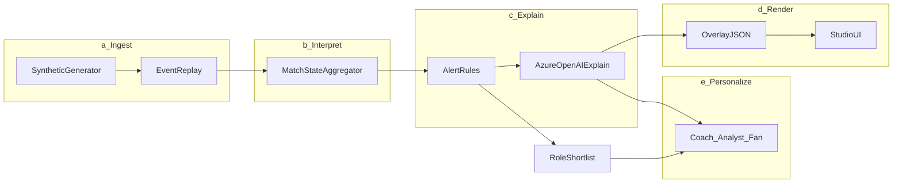
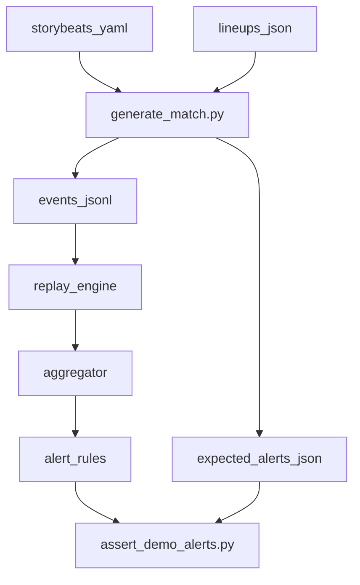

# PitchPulse AI — hackathon plan

## Product lock (no open choices)

- **Name:** PitchPulse AI  
- **Tagline:** From synthetic match events to coaching alerts and the profiles that close the gap  
- **Repo:** new public GitHub repo `pitchpulse-ai` under `~/projects/pitchpulse-ai` (not inside ScoutLense)  
- **Stack:** Python 3.12, FastAPI, pydantic models, Azure OpenAI for narratives/agent, Vite+React minimal studio UI, JSONL event store + in-memory match state  
- **Data:** **100% custom synthetic generator** (no StatsBomb/Impect/TM dumps in the repo). Fictional clubs/players only.  
- **Demo match:** one fully scripted 90' match with planted “story beats” so every pipeline stage is visible in &lt;2 min video  
- **Languages:** EN + HR for narratives  
- **IP wall:** patterns only from ScoutLense (tools + chat); zero copied MCP/DAO/warehouse code

## What the product does (mapped to judging)



| Stage | PitchPulse deliverable |
|---|---|
| Ingest | replay of `events.jsonl` at 1×/5×/10× with `t_ms` clock |
| Interpret | rolling possession, zone pressure, flank cross load, duel rate, pass quality, ball/shot speed |
| Explain | rule-fired alerts + LLM “why it matters” (control vs chaos, rhythm) |
| Render | timed overlay packets + studio alert rail |
| Personalize | same alert → Coach / Analyst / Fan copy (+ favorite player focus + language) |

Secondary (not the hero): `propose_roles_for_alert` → 3 synthetic roster profiles that “fix” the gap.

---

## Synthetic data design (core of this plan)

Data is **designed backwards from the alerts and demo narrative**, not generic football noise.

### 1. Entities

- `matches/syn-001/meta.json` — kickoff, scoreline arc, formations, fictional team names (e.g. Northbridge FC vs Riverdale United)  
- `matches/syn-001/lineups.json` — 22 starters + benches, shirt numbers, positions, `player_id`  
- `matches/syn-001/events.jsonl` — ordered events with monotonic `t_ms`  
- `roster/catalog.csv` — ~120 fictional players with attributes used only by shortlist (aerial, progressive_pass, press_intensity, pace, defensive_duels, cross_defend, etc.)  
- `storybeats/syn-001.yaml` — authoring file the **generator compiles** into events + expected alerts (source of truth for demo)

### 2. Event schema (stable contract)

Every line in `events.jsonl`:

```json
{
  "match_id": "syn-001",
  "event_id": "e0004821",
  "t_ms": 1245000,
  "period": 1,
  "type": "pass",
  "team_id": "home",
  "player_id": "H07",
  "opponent_id": null,
  "x": 62.1, "y": 18.4,
  "end_x": 78.0, "end_y": 12.0,
  "outcome": "complete",
  "metrics": {
    "distance_m": 18.2,
    "ball_speed_mps": 14.1,
    "pass_difficulty": 0.72,
    "pressure_on_ball": 0.65
  },
  "tags": ["into_box", "under_pressure"]
}
```

**Event types the generator must emit** (enough for rules + metrics judges care about):

- `pass`, `carry`, `shot`, `tackle`, `interception`, `aerial`, `foul`, `card`  
- `possession_change`, `pressure` (team/zone pressure pulse)  
- `duel` (defensive contact)  
- `cross` (as pass subtype via `tags` or `type: cross`)  
- `match_meta` (kickoff, half-time, full-time, score update)  
- optional `speed_burst` when player/ball crosses threshold (player ID tagging + speed callout)

Pitch coords: 0–100 x, 0–100 y (standard analytics pitch). Home attacks +x in first half; flip after HT in generator.

### 3. Story beats → planted alerts (demo reliability)

Author `storybeats/syn-001.yaml` with windows; generator densifies realistic filler events around them and **guarantees** thresholds fire.

| Beat window | Forced pattern | Alert id | Coach-facing gap |
|---|---|---|---|
| 12'–18' | Home right flank: high `cross` + `pressure` in attacking third; away LB low `duel` success | `flank_overload_right` | Need aerial / cross-defend fullback |
| 28'–34' | Away midfield: high `pressure` + turnover cluster; possession % swings | `chaos_press_mid` | Need press-resistant 6 / tempo control |
| 51'–58' | Home shots with high `ball_speed_mps` / `shot` xThreat proxies; GK saves | `shot_speed_spike` | Milestone narrative + Analyst speed metrics |
| 63'–70' | Away defensive third: low tackle/aerial contact rate vs entries | `low_defensive_contacts` | Need aggressive CB / duel winner |
| 78'–84' | Favorite player (`H09`) progressive passes + carries | `player_focus_surge` | Fan/player-focus mode showcase |
| 90'+ | FT | `match_recap` | Multi-language recap |

Each beat declares: `t_start_ms`, `t_end_ms`, `density`, `zone`, `team`, `metric_targets`, `expected_alert`.

### 4. Generator pipeline



Modules under `src/data/`:

- `pitch.py` — zones (left/right flank, box, mid thirds), coord helpers  
- `players.py` — load lineups, sample actors by position  
- `emitters.py` — typed event builders (pass/shot/duel/…) with realistic metric distributions  
- `beats.py` — load YAML, schedule forced patterns  
- `filler.py` — background possession/pass noise so the match feels continuous  
- `generate_match.py` — CLI: `python -m src.data.generate_match --match syn-001`  
- `validate_events.py` — schema + monotonic time + player IDs exist  

**Metric formulas (deterministic, explainable):**

- Pass difficulty ≈ f(distance, pressure_on_ball, progressive_delta_x, into_box)  
- Ball/shot speed sampled from beat targets or position-based priors  
- Zone pressure score = rolling count of `pressure`/`duel`/`tackle` in zone / 60s  
- Flank overload = crosses + final-third entries on one flank vs other over window  
- Defensive contact rate = successful `tackle`+`aerial` / defensive-third entries against  

### 5. Roster catalog (for shortlist only)

Synthetic players with fields aligned to alert→role mapping, e.g.:

`player_id, name, position, aerial, defensive_duels, cross_defend, press_resistance, progressive_pass, pace, style_tags`

Mapping table in code (not LLM-only):

- `flank_overload_right` → prefer `FB/WB` high `cross_defend`, `aerial`  
- `chaos_press_mid` → `CDM` high `press_resistance`, `progressive_pass`  
- `low_defensive_contacts` → `CB` high `defensive_duels`, `aerial`  

LLM may narrate why the profile fits; ranking is rule/score based so demos stay stable.

---

## Runtime architecture

```text
pitchpulse-ai/
  README.md
  LICENSE
  .env.example
  pyproject.toml
  data/
    matches/syn-001/{meta.json,lineups.json,events.jsonl,expected_alerts.json}
    roster/catalog.csv
    storybeats/syn-001.yaml
  src/
    data/           # generator + validation
    ingest/         # replay websocket/SSE
    interpret/      # MatchState, rolling windows
    explain/        # rules + Azure explain prompts
    render/         # overlay packet builder
    personalize/    # mode + language templates
    shortlist/      # role matching
    agent/          # tool definitions + Azure OpenAI agent loop
    api/            # FastAPI routes
  web/              # Vite React studio shell
  scripts/          # generate, assert_demo, demo_seed
  docs/ARCHITECTURE.md
```

### Interpret — `MatchState`

In-memory state updated per event:

- score, clock, possession %, pass accuracy, pass difficulty rolling avg  
- per-zone pressure, per-flank cross counts  
- per-player touches, distance proxy, max speed  
- open alerts + resolved alerts  

### Explain — hybrid

1. **Rules** fire when thresholds hit (stable for demo).  
2. **Azure OpenAI** fills `why_it_matters`, Coach action line, Analyst numbers blurb, Fan story — one structured JSON completion with three mode fields + `hr`/`en`.  
3. Cache explanations by `alert_id` so replay is cheap.

### Render — overlay packet

```json
{
  "t_ms": 1050000,
  "alert_id": "flank_overload_right",
  "severity": "warning",
  "graphic": {
    "type": "zone_highlight",
    "zone": "right_flank_final_third",
    "title": "Right flank overload",
    "subtitle": "6 crosses in 4 min"
  },
  "modes": {
    "coach": {"en": "...", "hr": "..."},
    "analyst": {"en": "...", "hr": "..."},
    "fan": {"en": "...", "hr": "..."}
  }
}
```

### Agent tools (7, thin)

1. `get_match_clock`  
2. `get_match_state`  
3. `list_alerts` / `explain_alert`  
4. `set_viewer_profile(mode, lang, favorite_player_id?)`  
5. `get_overlay_packet(alert_id)`  
6. `propose_roles_for_alert(alert_id)`  
7. `generate_match_recap`  

Chat UI calls the same services as the alert rail (single brain).

### API surface

- `GET /health`  
- `POST /replay/start|pause|seek`  
- `GET /replay/stream` (SSE of events + state snapshots)  
- `GET /alerts`  
- `POST /viewer`  
- `POST /agent/chat`  
- `GET /overlay/latest`  

---

## UI (studio shell, one composition)

First viewport: brand **PitchPulse**, live clock, pitch/zone hint, alert rail, mode toggle (Coach | Analyst | Fan), language, chat. No dashboard clutter. Alerts drive the story; shortlist appears as a side panel when Coach clicks “Who can fix this?”.

---

## Implementation order (execution sequence)

1. **Scaffold repo** — gitignore, pyproject, README pitch, `.env.example`, empty packages  
2. **Schema + storybeats YAML** for syn-001 (all 6 beats)  
3. **Generator** — emit events + `expected_alerts.json`; validation script  
4. **Aggregator + alert rules** — unit tests that replay asserts expected alerts  
5. **FastAPI replay SSE** — stream events to clients  
6. **Personalize + overlay** — templates; wire Azure OpenAI for explanations  
7. **Shortlist** — catalog + scoring  
8. **Agent tools + chat**  
9. **Web UI** — clock, alerts, modes, chat, shortlist drawer  
10. **Polish** — demo script, architecture doc, 2-min video checklist, GitHub public push  

---

## GitHub / submission hygiene

- Public repo from day one; commits tell the story (data → rules → agent → UI)  
- Secrets only in `.env` / GitHub Actions if deployed  
- README sections: Problem, 5-stage pipeline diagram, Quickstart (`generate` → `uvicorn` → `web`), Azure setup, Demo script timestamps, Judging checklist  
- Demo video: 0:00 brand, 0:20 flank alert across 3 modes, 0:50 explainability, 1:10 shortlist, 1:30 HR recap, 1:45 architecture one-liner  

---

## Explicit non-goals (keep scope hackathon-tight)

- No real Premier League data, no ScoutLense/Impect/TM  
- No video auto-eventing model (mention as future in README only)  
- No Airflow/Fabric lakehouse unless leftover time after vertical slice works  
- No large multi-match corpus — one perfect demo match beats ten shallow ones  
